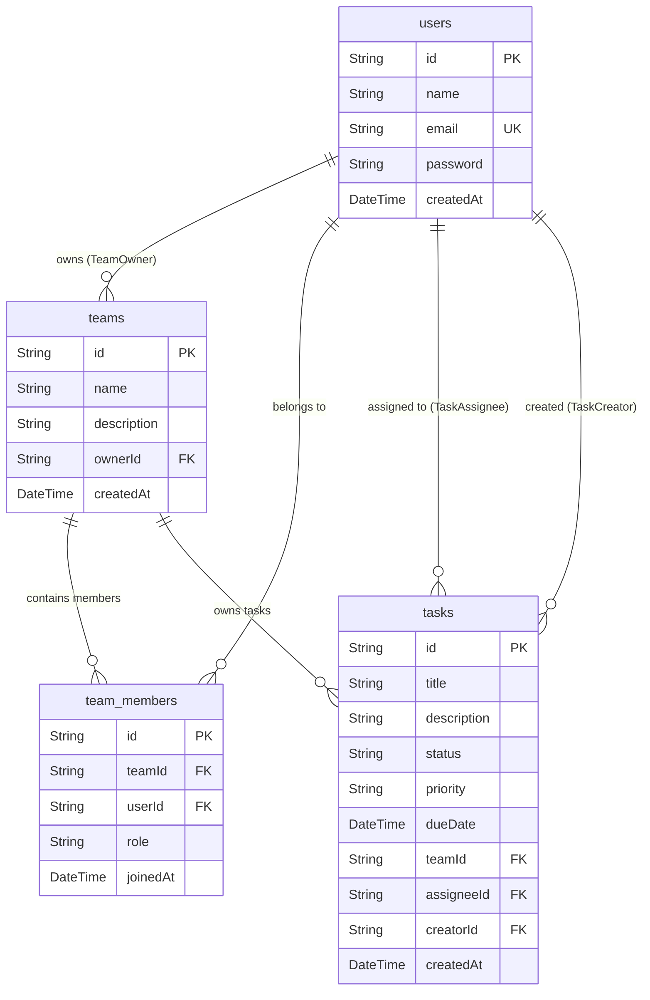

# 🚀 TaskFlow — Task & Team Management Web Application

> **Assignment 2:** Task & Team Management App: CRUD API with Authentication  
> **Course:** Web Application Development / Software Engineering  
> **Live Website (Vercel):** [https://assignment-1-project-setup-and-deployment.vercel.app](https://assignment-1-project-setup-and-deployment.vercel.app) *(or your Vercel deployment URL)*  
> **GitHub Repository:** [https://github.com/ThanhNam7791aaa/Assignment-1-Project-setup-and-deployment](https://github.com/ThanhNam7791aaa/Assignment-1-Project-setup-and-deployment)

---

## 🎓 Submission Information (Official Format)

```text
Student ID: [Your Student ID, e.g., QE123456]
Full Name: [Your Full Name]
GitHub Repository URL: https://github.com/ThanhNam7791aaa/Assignment-1-Project-setup-and-deployment
Deployed Website URL (Vercel): [Your Vercel URL]
Separate Backend URL (NestJS on Render) — write N/A if not used: N/A
Test Account Email: test@taskflow.com
Test Account Password: Password123!
This test account is already email-verified / ready to log in immediately, with no confirmation link needed (Yes / No): Yes
Self-registration works, so a grader can create their own account (Yes / No): Yes
```

---

## 📌 Project Overview

**TaskFlow** is an enterprise-grade full-stack Task & Team Management application built with **Next.js 16 (App Router)**, **Prisma ORM**, and **PostgreSQL (Supabase)**.

In **Assignment 2**, the platform is enhanced with:
- **JWT & bcrypt Authentication:** Secure registration, login, session persistence via httpOnly cookies, and logout.
- **Team Workspace Management:** Multi-team membership, role assignment (`OWNER` vs `MEMBER`), and member invitations by email.
- **Task Management with Role-Based Access Control (RBAC):** Task creation within teams, assignee delegation, status/priority updates, and strict delete authorization rules.
- **Interactive Kanban Board View:** Visual status columns (`To Do`, `In Progress`, `Done`) with instant status transitions.
- **Real-Time Task Filtering & Search:** Filter tasks by status, priority, or assignee, plus instant search.

---

## 🛠️ Tech Stack

- **Frontend & Route Handlers:** Next.js 16 (App Router, React 19, TypeScript)
- **Styling:** Tailwind CSS v4 (Modern responsive layout with dark/light mode accents)
- **Database:** PostgreSQL (Hosted on [Supabase](https://supabase.com))
- **ORM:** Prisma 6 (Schema modeling, migrations, client singleton)
- **Authentication:** JWT (`jose`) with `httpOnly` secure cookies & password hashing with `bcryptjs`
- **Continuous Integration:** GitHub Actions (`.github/workflows/ci.yml`)
- **Hosting & Deployment:** Vercel

---

## 🗄️ Database Design & ERD (Entity Relationship Diagram)



---

## 🔌 Complete RESTful API Endpoints

### 1. Authentication (`/api/auth`)
| Method | Endpoint | Description | Access |
| :--- | :--- | :--- | :--- |
| `POST` | `/api/auth/register` | Register a new user (`name`, `email`, `password`) | Public |
| `POST` | `/api/auth/login` | Login and receive JWT httpOnly session cookie | Public |
| `POST` | `/api/auth/logout` | Clear session cookie | Authenticated |
| `GET` | `/api/auth/me` | Get current logged-in user profile | Authenticated |

### 2. Team Management (`/api/teams`)
| Method | Endpoint | Description | Access |
| :--- | :--- | :--- | :--- |
| `GET` | `/api/teams` | List all teams the current user belongs to | Authenticated |
| `POST` | `/api/teams` | Create a new team (creator becomes `OWNER`) | Authenticated |
| `GET` | `/api/teams/:id` | Get team details, members, and tasks | Team Members |
| `PUT` | `/api/teams/:id` | Update team name or description | Team Owner Only |
| `DELETE` | `/api/teams/:id` | Permanently delete team and its tasks | Team Owner Only |

### 3. Team Member Management (`/api/teams/:id/members`)
| Method | Endpoint | Description | Access |
| :--- | :--- | :--- | :--- |
| `POST` | `/api/teams/:id/members` | Add member to team by registered `email` | Team Owner Only |
| `DELETE` | `/api/teams/:id/members/:userId` | Remove member from team (cannot remove owner) | Team Owner Only |

### 4. Task Management (`/api/teams/:id/tasks` & `/api/tasks/:id`)
| Method | Endpoint | Description | Access |
| :--- | :--- | :--- | :--- |
| `GET` | `/api/teams/:id/tasks` | List tasks for team with status/priority/assignee filters | Team Members |
| `POST` | `/api/teams/:id/tasks` | Create a new task within the team | Team Members |
| `PUT` | `/api/tasks/:id` | Update task details, status, priority, or assignee | Team Members |
| `DELETE` | `/api/tasks/:id` | Delete task | **Creator, Assignee, or Team Owner only** |

---

## 🌟 Bonus Features Implemented
- ✅ **Kanban Board View:** Switch between visual Kanban columns (`To Do`, `In Progress`, `Done`) and Table list view.
- ✅ **Filter & Search Tasks:** Filter by status, priority, or assignee, with instant title/description search.
- ✅ **Role-Based Authorization (RBAC):** Strict checks on team settings, member removal, and task deletion.
- ✅ **Pre-configured Grader Account:** 1-click test login credentials on the login screen.
- ✅ **GitHub Actions CI Workflow:** Automated lint & build checks on every push.
